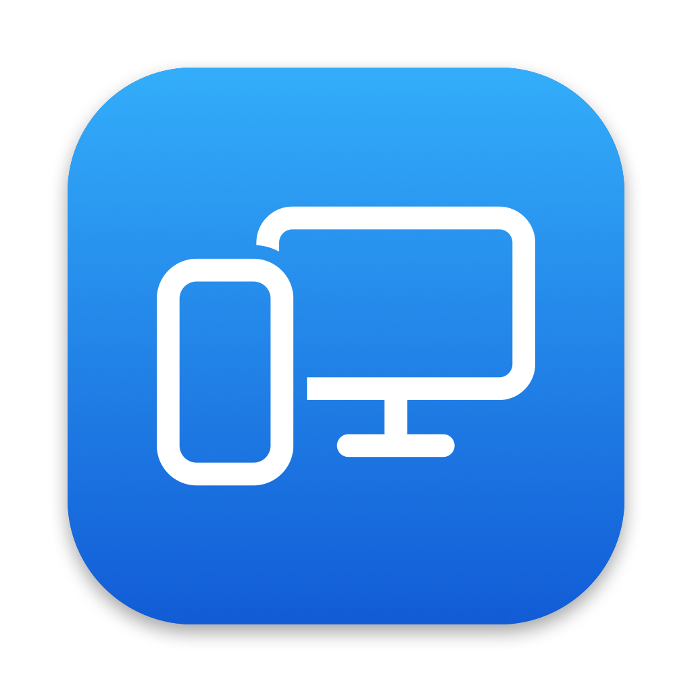

# Tether Desktop



A desktop peer for [Tether](https://github.com/zackb/tether), for macOS and Windows. The iPhone app sees it as one more computer, like `tetherd` on Linux, and paired computers share the clipboard and files with each other: copy on the Mac, paste on Windows or Linux.

The project started from one need: one set of apps that lets all the devices at hand share the clipboard and send files to each other.

Only the Wi-Fi features of Tether are here. Messages, notifications, calls and AirPods need Bluetooth, which only `tetherd` has.

## Features

- Pairs with the iPhone app and with other computers. You approve each pairing.
- Syncs clipboard text and images.
- Receives files into Downloads. Sends files from the menu, from Finder (Services > Send with Tether Desktop) or from Explorer (Send to > Tether Desktop).
- Opens links that the iPhone shares.
- Tells you when a new version is out.

## Install

Download the files from [Releases](../../releases). They are not signed by Apple or Microsoft.

macOS 15 or later on Apple silicon: open the dmg and drag TetherDesktop to Applications. The app is not notarized, so run this once before the first start:

```bash
xattr -dr com.apple.quarantine /Applications/TetherDesktop.app
```

Windows 11 x64: put the exe in `%LOCALAPPDATA%\Programs\TetherDesktop\` and start it. SmartScreen warns about it: choose More info, then Run anyway. Smart App Control blocks unsigned apps, so it must be off.

## Setup

On the first start, allow the network access that the system asks for: Local Network on macOS, private networks in the Windows firewall. If you closed the Windows prompt, the menu item Firewall Help copies a command that allows port 5134.

To pair the iPhone, open Tether on it, tap the computer, and click Allow on the computer. The iPhone keeps one connection at a time.

To pair a computer, choose Pair with a Computer in the menu. For `tetherd`, approve the request there or run `tether accept <fingerprint>`; the first menu item copies this computer's fingerprint. For another Tether Desktop, click Allow there. If the computer is not in the list, for example over Tailscale or across subnets, choose Enter Address.

Paired devices reconnect by themselves.

## Files and logs

| | macOS | Windows |
|---|---|---|
| Settings | `~/Library/Application Support/TetherDesktop/` | `%APPDATA%\TetherDesktop\` |
| Log | `log stream --predicate 'subsystem == "TetherDesktop"'` | `%LOCALAPPDATA%\TetherDesktop\tetherdesktop.log` |

Received files go to Downloads, marked as downloaded from the internet.

## Security

- A device can only ask to pair until you approve it. Paired devices are pinned by the SHA-256 of their certificate.
- The private key is in the settings folder, readable only by you. On Windows it is also encrypted with DPAPI.
- Logs never hold clipboard or file content, and content that a password manager marks as secret is not synced.
- A received file keeps only its plain name, and goes to Downloads only when it is complete. Limits: 4 GiB for a file, 32 MiB for a clipboard image.
- Only http and https links open.

## Development

Both apps are in Go, so that one code base serves both platforms. A Swift app for macOS would have meant two code bases.

- `go/core`: the engine. It does TLS, pairing, sessions, clipboard sync and files, and has no platform code.
- `go/cmd/tetherdesktop`: the app. `tray.go` is the menu for both platforms; `*_windows.go` uses Win32, and `*_darwin.go` with `macos_darwin.m` uses AppKit.
- `go/third_party/systray`: a patched copy of fyne.io/systray, see its `PATCHED.md`.

[docs/protocol.md](docs/protocol.md) lists the rules that `go/core` follows, so that several computers sync without loops.

### Build

```bash
scripts/build-macos.sh     # build/TetherDesktop.app: macOS 15, Xcode command line tools, Go 1.27
scripts/build-windows.sh   # build/go/TetherDesktop.exe: on any OS
```

`build-macos.sh` signs the app with the certificate "Tether Desktop Local Code Signing" if the keychain has it. With the same certificate, macOS keeps the Local Network permission across builds; signed ad hoc, the app asks again after each build. `scripts/make-icons.swift` draws all icons.

### Test

```bash
cd go
go test -race ./core
```

The tests run several engines on one machine: a fake iPhone, two computers and a ring of three. `scripts/tetherd-container.sh` runs a real `tetherd` in Docker for `go/core/tetherd_test.go`. `go run ./cmd/tether-browse` lists the Tether services on the network, and `cmd/tether-headless` runs the engine without a user interface.

### Release

CI runs the tests and builds both apps. Push a tag such as `v0.2.0`, and `.github/workflows/release.yml` builds the dmg and the exe and publishes them. It signs the app with the certificate in the secrets `MAC_CERT_P12` and `MAC_CERT_PASSWORD`.

Each release also publishes `update.json`, which the apps read once a day. To force an update, for example after a security fix, raise `scripts/min-version` before the release. Older apps then stop syncing and ask for the update, and newer apps close sessions with older ones.

## License

MIT, see [LICENSE](LICENSE). `go/third_party/systray` is under the Apache License 2.0.
